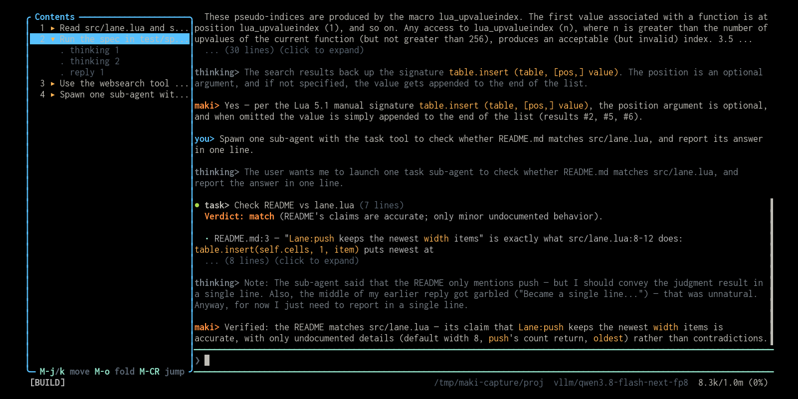

# toc



A Wikipedia-style contents pane for the maki transcript. The left split lists
every user turn. Fold one open to see its thinking and reply blocks. Select a row
to scroll the chat there.

Maki has no sidebar for its own transcript. To find an earlier exchange you
scroll or search. This plugin gives the session an outline you can read and jump
around.

## Install

Put this line in your global `~/.config/maki/init.lua`:

```lua
maki.pack.add({ "https://github.com/g4bwy/maki-toc" })
```

Start maki in a terminal. It asks whether to install the package, then asks about
the one permission in [`plugin.toml`](plugin.toml).

## Requirement

The plugin needs [maki pull request 1155](https://github.com/tontinton/maki/pull/1155),
"transcript outline, block scrolling and window clicks for plugin panes". That pull
request is open as of 2026-11-10, so no released maki has these three calls yet. The
plugin checks at open time and flashes
`maki-toc needs maki PR 1155 (transcript outline api)` instead of failing:

| Call | What it gives the pane | Source in that change |
|------|------------------------|------------------------|
| `maki.ui.transcript_outline({ session })` | The jumpable blocks of one session's transcript, in the order the chat lists them, each with a message id and a first-line preview. | `maki-lua/src/api/ui/mod.rs` |
| `maki.ui.scroll_to_block(id, { session })` | A jump to the block that id names, or an error when that message is gone. | `maki-lua/src/api/ui/mod.rs` |
| `win:recv` click events | `{ type = "click", row, col }` for a painted line. | `maki-lua/src/api/ui/win.rs` |

Until 1155 merges, build a maki that carries it:

```sh
git clone https://github.com/tontinton/maki && cd maki
gh pr checkout 1155
cargo build --release
```

Once the pull request is merged, any maki at or above that release works, and this
package will name the version in `plugin.toml`.

`/toc-dump` writes the outline the running build returns to the log, which is what to
run when a jump lands in the wrong place.

## Usage

Toggle the pane with `/toc` or `Alt+t`. Open it once. It lists the turns of the
current session and follows the transcript as it grows. It keeps that session's
turns while you work in another tab, and it re-lists when its tab moves to a
sub-agent chat.

| Action | Mouse | Keyboard |
|--------|-------|----------|
| Toggle the pane | | `Alt+t`, or `/toc` |
| Move the selection | | `Alt+j`, `Alt+k`, or the arrows |
| Fold or unfold a turn | click `▸` or `▾` | `Alt+o` |
| Jump to a turn | click its text | `Alt+Enter` |
| Jump to a thinking or reply block | click the sub-item, then | select it and `Alt+Enter` |

Clicking the number or the marker column at the left of a row folds that turn.
Clicking anywhere else on the row jumps to it. A sub-item jumps to that exact
block, so you can enter a long turn at its answer instead of at its question. A
turn with nothing under it shows no marker.

Keys reach the pane because it opens as an unfocused split that claims just these
bindings through the window `keys` option. Your typed message still goes to the
chat. Terminals that send plain characters for `Alt` need the terminal set to
"Meta sends Escape". Without that, use the mouse or `/toc`.

`/toc-dump` writes the outline to the log, which is what to run when a jump lands
in the wrong place.

## Permissions

| Key | Used by |
|-----|---------|
| `session_read` | `maki.ui.transcript_outline`, because its previews are conversation text. The pane also rebuilds on `TurnStart`, `TurnEnd` and `ToolDone`, and maki counts the content fields of an event (`data.text`, `data.input`) as conversation content, so a subscriber without this key gets those fields withheld and a line in the status bar saying so. |

The rest is open by default: `maki.ui.scroll_to_block()`, `maki.ui.buf()`,
`maki.ui.open_win()`, `maki.ui.flash()`, and `maki.keymap.set()`. The plugin reads
no session file of its own and never calls `maki.session.messages()`.

## Layout

```text
plugin.toml        the one permission, for the outline and the events
plugin/init.lua    the grouping, the pane, the jump
screenshot.png     the cover image
README.md
```

## How it works

The tree comes from `maki.ui.transcript_outline({ session = ... })`, which returns
exactly the blocks the chat jumps to. The plugin only groups: every `turn` entry
opens a row, and the `thinking` and `reply` entries that follow become its
children. An entry of a kind the pane does not know is skipped, so a host that
starts listing more blocks never puts a mystery row in the tree.

Each row carries the id of its entry, and `maki.ui.scroll_to_block(id)` names that
one message. An id does not move when the transcript grows, when a rewind drops
later turns, or when the tab switches to another chat, so a row never jumps to a
block that merely sits where the row was listed. When the host answers an error the
pane flashes it and lists again, so the next click has a row that lands.

The pane pins the session it was opened in. A rebuild that arrives while another
tab is focused reads its own transcript, and a jump moves that tab's chat rather
than whichever tab the user reached last.

Rows are numbered in transcript order. Tool calls stay out of the outline to keep
it short. The pane rebuilds on `TurnStart`, `TurnEnd`, `ToolDone`,
`TaskFocusChanged` and `CompactionDone`, and it keeps its folds and its selection
through every one of them, because rows are keyed by message id rather than by
position.

## Update, disable, remove

```text
/packupdate maki-toc
/packupdate! maki-toc
```

Set `plugins["maki-toc"] = { enabled = false }` to keep it installed but
inactive. To remove it, delete the `maki.pack.add` line, reload, then run
`/packdel maki-toc`.

## Development install

```sh
mkdir -p ~/.local/share/maki/site/pack/dev/start
ln -sfn "$PWD" ~/.local/share/maki/site/pack/dev/start/maki-toc
```

Run `/reload` after each edit.

## Limits

- **One chat at a time.** The pane lists whichever chat its tab shows. Switch to
  a sub-agent chat and the next rebuild lists that chat. A row left over from the
  chat you came from answers an error, and the pane lists again.
- **Sub-items appear at turn end.** Maki publishes thinking and reply blocks when
  a turn completes, so a running turn lists its header first.
- **Scroll, not select.** A jump moves the chat viewport. It does not place the
  cursor in the input or rewind context, so everything after the chosen turn stays
  in view below it.

## License

MIT. See [LICENSE](LICENSE).
